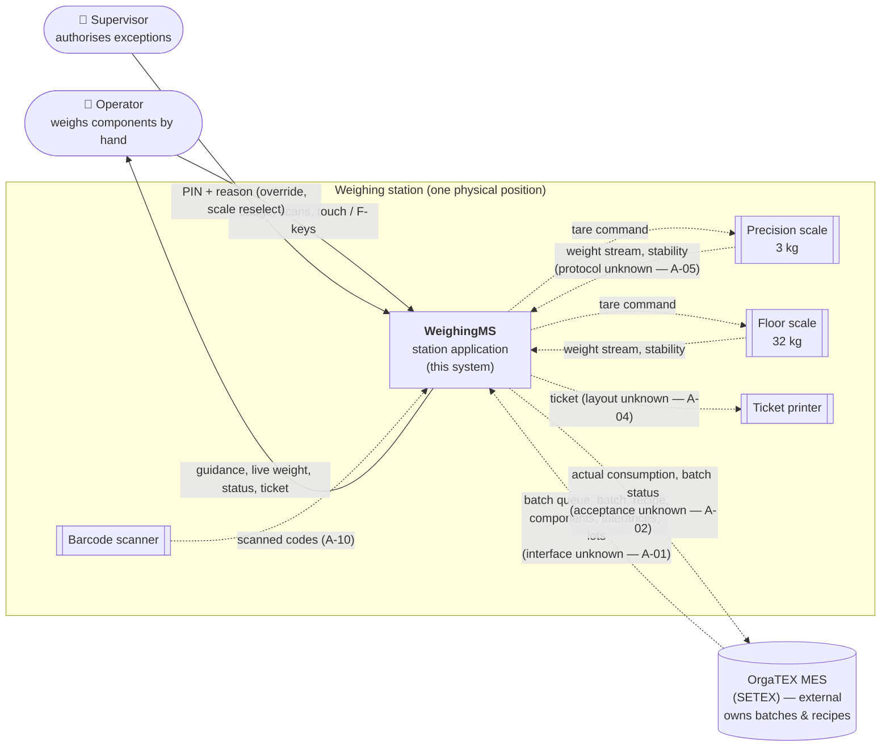
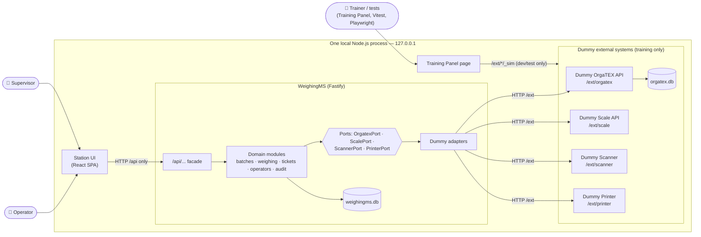

# Assisted Weighing Station - System Context

## System Overview

**WeighingMS** is the weighing-station application. It receives work (batches, recipes) from **OrgaTEX**, guides the **Operator** through weighing each component on a **Scale**, captures identities with a **Scanner**, records every weighing, posts actual consumption back to OrgaTEX, and prints a ticket on a **Printer**. The **Supervisor** authorises exceptions.

WeighingMS does **not** replace OrgaTEX: OrgaTEX remains the upstream source of batches and recipes and the downstream recipient of consumption (C-01, C-02). WeighingMS does not control any dispensing machinery (C-03).

This context distinguishes two layers:

| Layer | What it describes | Status |
|-------|-------------------|--------|
| **Conceptual (real) context** | The real systems and devices WeighingMS would integrate with at FCI | Interfaces **unknown / unconfirmed** (A-01, A-02, A-04, A-05, A-10) |
| **Training context** | The Dummy substitutes this intent builds and runs against | **Training contracts only** — not claims about the real interfaces |

The same WeighingMS **ports** (`OrgatexPort`, `ScalePort`, `ScannerPort`, `PrinterPort`) separate WeighingMS from both layers; only the adapters differ (`system-architecture.md`).

---

## Context Diagram

### A. Conceptual context (real systems — interfaces unconfirmed)

Dashed lines = interfaces whose technology and contract are **not known**.

### B. Training context (what this intent builds and runs)

---

## Actors

| Actor | Type | Interaction with WeighingMS | Requirements |
|-------|------|-----------------------------|--------------|
| **Operator** | Human, primary user | Identifies by badge; selects batch (scan/touch); verifies dyestuff, lot, container by scan; dispenses by hand watching live weight; confirms (OK F1), re-tares (F2), quits (F4); requests override; prints ticket; next batch (F3) | FR-1 … FR-31 |
| **Supervisor** | Human, privileged | Authorises tolerance override (PIN + mandatory reason) and manual scale reselection at the station | FR-12, FR-22, TD-6 |
| **Trainer / test runner** | Human / automated, **training only** | Drives dummy systems through the Training Panel or `_sim` endpoints (dispense, overshoot, outages); never part of the operator flow | DB-6, DB-7 |
| Lab / QA, Store, FCI IT | Human, indirect | Consume records/consumption via OrgaTEX or future reports; **no direct interaction in this intent** (history & supervisor view deferred, TD-4) | — |

## Systems and devices

| Element | Kind | Role | Conceptual interface | Training substitute |
|---------|------|------|----------------------|---------------------|
| **WeighingMS** | System under construction | Station application: guidance, rules, records, integration | — | — (real code) |
| **OrgaTEX MES** (SETEX) | External system | Source of batch queue, recipes, components, tolerances, dyestuff/lot data; recipient of actual consumption and weighing status | Unknown (brief assumes REST — A-01; write-back assumed — A-02) | **Dummy OrgaTEX API** `/ext/orgatex` + `orgatex.db` |
| **Precision scale (3 kg)** | Device | Live net weight, stability, tare for dye components | Unknown (≥10 Hz stream assumed — A-05) | **Dummy Scale API** `/ext/scale` (`scale-3kg`) |
| **Floor scale (32 kg)** | Device | Same, for auxiliaries | Unknown (A-05) | **Dummy Scale API** (`scale-32kg`) |
| **Barcode scanner** | Device | Badge, batch, dyestuff, lot, container codes | Unknown (keyboard-wedge/serial assumed — IR-15, A-10) | **Dummy Scanner** `/ext/scanner` + typed entry |
| **Ticket printer** | Device | Weighing ticket that travels with the container | Unknown (A-04, Q18) | **Dummy Printer** `/ext/printer` |

---

## External Integrations

- **OrgaTEX**: receive work (batch queue, batch, recipe, lots); send results (consumption, status). *Training: Dummy OrgaTEX via `OrgatexPort`.*
- **Scales**: read live net weight and stability; command tare; read calibration/connection status. *Training: Dummy Scale via `ScalePort`.*
- **Scanner**: receive scanned codes. *Training: Dummy Scanner via `ScannerPort`; typed entry always available.*
- **Printer**: send ticket; read printer status. *Training: Dummy Printer via `PrinterPort`.*

---

## Data Flows

### Inbound (into WeighingMS)

| # | From | Data | When | Validation in WeighingMS | Req |
|---|------|------|------|--------------------------|-----|
| I-1 | Operator | Badge ID | Session start | Known, active operator | FR-1 |
| I-2 | Operator (scanner / typed) | Batch ID | Batch selection | In queue; status RELEASED or WEIGHING | FR-3, FR-4 |
| I-3 | Operator (scanner / typed) | Dyestuff code, lot ID, container ID | Per component | Code = component dyestuff; lot belongs to dyestuff; container known & in service | FR-7, FR-8, FR-9 |
| I-4 | Operator | Commands: select component, OK, Re-tare, Quit, Override, Print, Reprint, Retry, Next batch | Throughout | Allowed in current state; OK re-evaluated server-side | FR-6, FR-18, FR-23, FR-24 |
| I-5 | Supervisor | PIN + reason; chosen scale | Override / reselection | Supervisor role; reason non-empty; scale capacity sufficient | FR-12, FR-22 |
| I-6 | OrgaTEX | Batch queue (id, order, machine, fabric, shade, component count, status, received time) | Queue load / refresh | Required fields present; unknown statuses not selectable | FR-2 |
| I-7 | OrgaTEX | Batch detail; recipe: sequence, dyestuff (name, code, colour, short name), target + unit, tolerance, bar full-scale, suggested lot | Batch selection | Quantities parsed as decimals; units g/kg; tolerance > 0 | FR-5, FR-8 |
| I-8 | Scale | Net weight + unit, `stable`, `connected`, timestamp | 10 Hz while weighing | Connected; reading ≤ 2 s old; decimal | FR-14, FR-33 |
| I-9 | Scale | Scale list, capacity, resolution, calibration due, status | Selection / status bar | Calibration not expired | FR-11, FR-13 |
| I-10 | Scanner | Scan events (code + type) | On scan | As I-2/I-3 | FR-34 |
| I-11 | Printer | Print result, printer status | On print / status bar | — | FR-35 |

### Outbound (from WeighingMS)

| # | To | Data | When | Guarantee | Req |
|---|----|------|------|-----------|-----|
| O-1 | Operator (screen) | Queue, recipe, live weight, zones, status, surplus, summary, write-back status, peripheral status | Continuous | Never shows hard-coded scenario data; every failure has a visible state | FR-2 … FR-32 |
| O-2 | Scale | Tare command | Weighing unlocked; Re-tare | Applied before dispensing; tare value recorded | FR-10, FR-23 |
| O-3 | OrgaTEX | Actual consumption per component (dyestuff, lot, actual + unit, target, result) against the batch, with `Idempotency-Key` | Batch completion; Retry | **Exactly-once effect** (idempotent); held PENDING if unreachable | FR-27, FR-28 |
| O-4 | OrgaTEX | Batch status WEIGHING / WEIGHED | Session start / completion | Only the batch status is written; nothing else in OrgaTEX is modified (C-02) | FR-26, FR-27 |
| O-5 | Printer | Ticket (header, components TGT/ACT, verdict, batch barcode, REPRINT marker) | Print / reprint / retry | Ticket stored before sending; retry re-sends the same ticket | FR-29, FR-30, FR-35 |

### Internal records (stay in WeighingMS)

Weighing sessions, weighing records (with snapshots), overrides, audit events, write-back state, tickets — persisted in `weighingms.db`, append-only (NFR-5, NFR-8, NFR-9).

---

## Data Ownership

| Data | Owner (master) | WeighingMS role | Training location |
|------|----------------|-----------------|-------------------|
| Batch header and status | OrgaTEX | Read; writes **only** weighing status | `orgatex.db` |
| Recipe, components, tolerances | OrgaTEX | Read-only (C-01) | `orgatex.db` |
| Dyestuff master, lots | OrgaTEX (lots: if available — A-09) | Read-only | `orgatex.db` |
| Actual consumption | OrgaTEX (receives) | Produces and posts | posted to `orgatex.db`; WeighingMS keeps its source records |
| Operators, supervisors | WeighingMS (or FCI directory — A-09) | Master | `weighingms.db` (seed) |
| Containers and tares | WeighingMS | Master | `weighingms.db` (seed) |
| Scale configuration, calibration | WeighingMS | Master; live state read from device | config / Dummy Scale |
| Weighing sessions, records, overrides, audit, tickets | WeighingMS | Master | `weighingms.db` |
| Live weight, stability, connection | Scale (device) | Read | Dummy Scale (in-memory) |
| Simulation state (outages, injected weights) | Dummy systems (**training only**) | Never read by domain logic | Dummy systems (in-memory) |

Rule: WeighingMS **never** reads `orgatex.db` directly; it only uses the Dummy OrgaTEX HTTP API through `OrgatexPort` (`data-stack.md`).

---

## Integration Boundaries

| Boundary | Inside | Outside | Crossing mechanism | Contract status |
|----------|--------|---------|--------------------|-----------------|
| **B1 UI ↔ WeighingMS** | — | Station UI | HTTP `/api/...` (`api-conventions.md`) | Owned by this project |
| **B2 WeighingMS ↔ OrgaTEX** | Domain modules | OrgaTEX | `OrgatexPort` → adapter → (training) `/ext/orgatex` | **Training contract**; real interface unknown (A-01, A-02) |
| **B3 WeighingMS ↔ Scales** | Domain modules | Scale devices | `ScalePort` → adapter → (training) `/ext/scale` | **Training contract**; protocol unknown (A-05) |
| **B4 WeighingMS ↔ Scanner** | Domain modules | Scanner | `ScannerPort` → adapter → (training) `/ext/scanner`; typed entry | **Training contract** (A-10) |
| **B5 WeighingMS ↔ Printer** | Domain modules | Printer | `PrinterPort` → adapter → (training) `/ext/printer` | **Training contract** (A-04) |
| **B6 Training controls** | Dummy systems | Trainer / tests | `/ext/*/_sim/...` | Training only; disabled outside dev/test |

Replacing any dummy with a real integration = a new adapter behind the same port; B1 and the domain modules do not change.

---

## Failure Boundaries

What can fail at each boundary, how it is detected, what WeighingMS does, and what is protected.

| Failure | Boundary | Detection | WeighingMS behaviour | Protected (never lost / never wrong) | Req |
|---------|----------|-----------|----------------------|--------------------------------------|-----|
| OrgaTEX unreachable at queue/recipe load | B2 | Adapter timeout / error → 503 `ORGATEX_UNAVAILABLE` | "OrgaTEX not reachable" + Retry; status bar ORGATEX OFFLINE; no empty/stale queue | No batch can start without a recipe | FR-36 |
| OrgaTEX unreachable during a batch | B2 | Same | Weighing continues (recipe held by the session) | Confirmed records | FR-36, TD-1 |
| OrgaTEX unreachable / rejects at write-back | B2 | Same / 4xx-5xx | Batch complete locally; write-back **PENDING** + Retry; pending count | Records; exactly-once posting (idempotency key) | FR-28, NFR-7 |
| Scale disconnected / not responding | B3 | No successful reading for 2 s or `connected: false` | Readout "unavailable", OK disabled; server rejects confirm (503 `SCALE_UNAVAILABLE`); re-tare on return | No weighing recorded from a stale/absent reading | FR-33, NFR-3 |
| Scale unstable | B3 | `stable: false` | OK disabled with reason | No confirmation of a settling value | FR-18, TD-9 |
| Scale calibration expired | B3 | Calibration due < now | Scale shows CAL EXPIRED; not selectable; confirm refused | No weighing on an expired scale | FR-13 |
| Scanner unavailable | B4 | Dummy status offline | SCANNER offline; typed entry for all codes, same validation | Validation unchanged | FR-34 |
| Wrong scan (dyestuff, lot, container, batch) | B4 / I-2, I-3 | Validation | Rejected with message; nothing unlocks | Identity integrity | FR-3, FR-7–FR-9 |
| Printer unavailable / out of paper | B5 | Print error / status | "Printer unavailable" + Retry; preview available | Ticket stored; batch & write-back unaffected | FR-35 |
| Out-of-tolerance weight (under/over) | Domain | Rule evaluation (UI + server) | OK disabled; surplus shown if over; recovery per Step 24; override requires supervisor | No out-of-tolerance record without override | FR-17, FR-18, FR-20–FR-22 |
| Operator quits mid-component | B1 | Quit command | Abandon unconfirmed weighing; back to queue; batch resumable | Confirmed records unchanged | FR-24 |
| Browser reload / process restart | B1 / process | Session lookup on load | Resume at in-progress component | Confirmed records durable before acknowledgment | NFR-5, NFR-6 |
| Crafted / invalid API request | B1 | Schema + rule validation | 400 / 409 / 422 with error code; nothing recorded | Rules enforced server-side | FR-18, NFR-14 |

**Failure containment rule:** a failure at B2–B5 never crashes the UI, never silently proceeds, and never alters a confirmed weighing record.

---

## High-Level Constraints

- OrgaTEX is the single source of truth for batches and recipes; WeighingMS writes only weighing status and consumption (C-01, C-02).
- No connection to or control of dispensing machinery (C-03).
- Dummy contracts are **training contracts**, not real OrgaTEX/device interfaces; the brief's illustrative `/api/v1` shapes are not adopted.
- One station, one local process on `127.0.0.1` (`tech-stack.md`); the UI talks only to `/api`, adapters only to `/ext`.
- All scenario data comes from dummy seed data via APIs — never from the UI (workbook Rule 5).

## Key NFR Goals

- Live weight ≥ 10 Hz, ≤ 200 ms lag; disconnection visible within 2 s (NFR-1, NFR-3).
- Recipe on screen ≤ 3 s after selection (NFR-2).
- Confirmed weighings durable and immutable; exactly-once consumption posting (NFR-5, NFR-7, NFR-8).
- Every external failure produces a defined, safe, visible state (Failure Boundaries above).

## Completeness check

| Question | Answer |
|----------|--------|
| Missed third-party integrations? | None in the sources. A container master or FCI user directory might exist at FCI (brief §9.3, A-09) — modelled as WeighingMS-owned seed data for training |
| Legacy systems? | The paper process (A-13) — replaced, not integrated |
| Planned future integrations? | Real OrgaTEX adapter; real scale/scanner/printer drivers; multi-station; background sync (deferred, TD-1); supervisor view and history (deferred, TD-4). The port boundaries above accommodate all of them |
