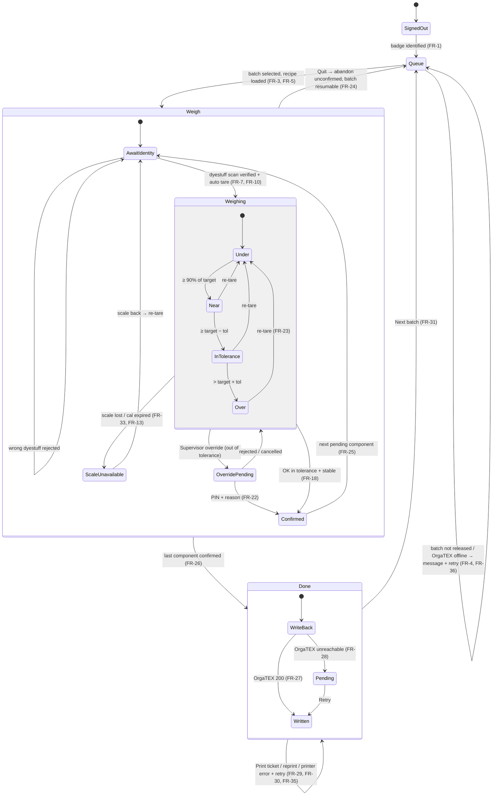

# UI/UX Analysis: customize-weighing-station.html

Analysis of the supplied prototype **as a functional prototype** — what it shows, does, assumes and leaves open. It is **not a redesign** and contains no implementation. Findings are mapped to the prototype (`L###` = line in `docs/customize-weighing-station.html`; `#id` / `.class` = element; `fn()` = JavaScript function) and to the approved requirements (`FR-`, `TD-`, `DB-` = `requirements.md`).

## 0. What the file is

| Layer | Prototype location | Product treatment (`ux-guide.md`) |
|-------|--------------------|-----------------------------------|
| Page masthead ("Mockup for discussion", draft flag) | L411–420 — **commented out** in the supplied file | Not reproduced |
| Controls bar: view switcher, ▶ Simulate dispense, ▶ Simulate overshoot, Reset, Show question pins | `.controls` L422–435 | Relocated to Training Panel (DB-6, DB-7) |
| **Device → HMI screen**: top bar, 3 views, status strip | `.device` / `.screen` L438–630 | **Reproduced** |
| Reviewer notes (3) and question pins (11 placed in the screen) | `.notes` L633–665, `.pin` spans | Not reproduced; questions carried to `requirements.md` Open Questions |
| Script: data, rendering, zone logic, simulation | L675–866 | Behaviour reference only; not copied |

The screen is a **single-page, view-switched** UI: one `.screen` with three `.view` panels (`#v-queue`, `#v-weigh`, `#v-done`) toggled by `showView()` (L829); the top bar and status strip are always visible.

---

## 1. Screen inventory

| # | Screen | Prototype | Purpose | Reached by (in prototype) | Requirements |
|---|--------|-----------|---------|---------------------------|--------------|
| S0 | *(Operator sign-in)* | **Absent** — operator "R. Karim · Shift A" is hard-coded in the top bar (L444) | Identify operator | — | FR-1 (new screen/step) |
| S1 | **1 · Select batch** | `#v-queue` L448–488 | Scan or touch a batch from the OrgaTEX queue | Controls bar only — **rows have no click handler** | FR-2, FR-3, FR-4, FR-36 |
| S2 | **2 · Weigh** | `#v-weigh` L490–565 (default active view) | Guided weighing of the active component | Controls bar; initial view | FR-5 … FR-25 |
| S3 | **3 · Confirm & print** | `#v-done` L567–616 | Batch summary, OrgaTEX write-back, ticket | `btn-ok` after the last pending component (L820) or controls bar | FR-26 … FR-31 |
| — | Persistent top bar | `.topbar` L440–446 | Station, batch/order/machine crumb, operator chip | Always | FR-1, FR-3 |
| — | Persistent status strip | `.strip` L618–628 | Peripheral and OrgaTEX status, language, clock | Always | FR-32 |
| S4 | *(Supervisor authorisation)* | **Absent** — override only changes the status text (L824–826) | PIN + reason | — | FR-22, FR-12 (new dialog) |
| S5 | *(Training Panel)* | Equivalent of `.controls` | Drive dummy systems | — | DB-7 |

---

## 2. UI component inventory

| Component | Prototype element | Content / behaviour | Product component (`ux-guide.md`) |
|-----------|-------------------|---------------------|-----------------------------------|
| Brand mark | `.brandmark` L441 | "WeighingMS" + "STATION 01" | `TopBar` |
| Crumb | `.crumb` L442 | "BATCH B-24187 · ORDER SO-9931 · MACHINE JET-04" (static) | `TopBar` |
| Operator chip | `.op-chip` L444 | Green dot, "Operator R. Karim · Shift A" | `OperatorChip` |
| Scan prompt | `.scan-prompt` L450–456 | Animated scanner beam (`.beam`), "Scan a batch card to begin", "Or touch a row below. Queue received from OrgaTEX at 06:12." | `BatchQueue` header |
| Batch queue table | `table.q` L458–486 | Columns Batch / Order / Machine / Fabric / lot / Shade / Comp. / Status; selected row `tr.sel`; status tag `.tag` / `.tag.now` (amber "WEIGHING") | `BatchQueue` |
| Recipe rail header | `.rail-head` L493–497 | "Recipe · Teal 4C", "B-24187", "`#rail-done` of 5 components weighed" | `ComponentRail` |
| Component row | `.comp` built by `renderComps()` L696 | Colour swatch, name, "code · scale" sub-line, target qty + unit, state line ("✓ actual" / "WEIGHING" / "PENDING"); `data-state` done/active/pending; button (touch to select) | `ComponentRow` |
| Component header | `.weigh-head .who` L502–505 | `#w-name` name; `#w-meta` "code · LOT · CONTAINER · TARE" | `WeighPanel` header |
| Scale badge | `.scale-badge` L506–510 | "Scale selected", `#w-scale` ("3 kg precision"), "automatic" | `ScaleBadge` |
| Readout | `.readout` L512–528 | Three `.cell`s: **Weighed now** (`#w-now`, 52 px, zone-coloured), **Still to weigh** (`#w-left`), **Target** (`#w-target`); unit spans `#u1–#u3` | `Readout` / `ReadoutCell` |
| Progress bar | `#bar` L531–535 | `role="progressbar"`; `.fill` (zone colour), `.band` (tolerance), `.target-line`; `data-zone` | `ToleranceBar` |
| Bar caption | `.bar-caption` L536–540 | "0", `#cap-band` "TOLERANCE ±0.5 g (93.5 – 94.5)", `#cap-max` "125 g" | `ToleranceBar` |
| Status line | `#status` L541 | Zone-coloured instruction text | `StatusMessage` |
| Surplus panel | `#surplus` L544–554 | Visible only in *over* (`.surplus.on`): headline, table of remaining components old → new target, "Proposal: recalculate…" | `SurplusPanel` (content per Step 24) |
| Action keys | `.actions` L556–562 | `#btn-ok` "OK · Confirm F1" (green, disabled unless ok), `#btn-retare` "Re-tare F2", `#btn-quit` "Quit F4" (ghost), `#btn-override` "Supervisor override" (ghost, right-aligned, no F-key) | `Key` |
| Done summary | `.done-msg` L569–585 | "Batch B-24187 weighed"; rows Components weighed / All within tolerance / Total dispensed / Elapsed / Operator / Written to OrgaTEX; transport sentence; keys "Print ticket F1", "Next batch F3" | `CompletionSummary`, `Key` |
| Ticket | `.ticket` L590–611 | Monospace ticket: title, header fields, component TGT/ACT table, verdict, `#barcode`, batch ID; caption "Label content is invented." | `Ticket`, `Barcode` |
| Status strip | `.strip` L618–628 | `.stat` items with `.dot.up` (green) / `.dot.warnd` (amber): SCALE 3 kg · READY, SCALE 32 kg · READY, SCANNER, PRINTER, ORGATEX · LINKED 07:41 (amber), EN, `#clock` | `StatusStrip` |

---

## 3. User actions

| Action | Prototype trigger | Prototype effect | Product requirement |
|--------|-------------------|------------------|---------------------|
| Select batch by scan | Prompt text only — **not implemented** | — | FR-3 (scan or typed) |
| Select batch by touch | Row — **no handler** | — | FR-3, FR-4 |
| Select a component | Click `.comp` → `select(i)` L718 | Done rows ignored; previous active → pending; clicked → active; weight reset | FR-6, TD-13 |
| Dispense (operator pours) | ▶ Simulate dispense → `run(target + 0.4·tol)` L802 | Weight eases up to a landing inside tolerance | FR-14 via Dummy Scale (DB-6) |
| Overshoot | ▶ Simulate overshoot → `run(target + 4.8·tol)` L806 | Weight eases past the band; surplus panel shows | FR-20 via DB-6 |
| Confirm (OK F1) | `#btn-ok` L814 | `actual = now`; state done; first pending (array order) becomes active; if none → `showView("done")` | FR-18, FR-19, FR-25, FR-26 |
| Re-tare (F2) | `#btn-retare` → `reset()` L811 | Weight → 0 | FR-23 |
| Quit (F4) | `#btn-quit` → `reset()` L812 | **Identical to Re-tare** (weight → 0) | FR-24, TD-14 (defines a distinct safe exit) |
| Supervisor override | `#btn-override` L824 | Status text "OVERRIDE REQUESTED — AWAITING SUPERVISOR"; nothing else | FR-22, TD-15 |
| Print ticket (F1) | Done-screen key — **no handler** | — | FR-29, FR-35 |
| Next batch (F3) | Done-screen key — **no handler** | — | FR-31 |
| Switch view | Controls bar `.seg` buttons → `showView()` | Free navigation between all three views | Not reproduced (navigation follows the workflow) |
| Toggle question pins | `#pin-toggle` | Shows/hides pins | Not reproduced |
| Keyboard F1/F2/F3/F4 | Labels only — **no key handlers** | — | NFR-12 |

---

## 4. Application states

### 4.1 View state
`queue` · `weigh` · `done` (one active at a time; `showView()` L829).

### 4.2 Component state (`data-state`, L696–716)
`pending` → `active` ("WEIGHING") → `done` ("✓ actual"); `active` → `pending` when another component is selected. `done` is terminal (`select()` returns early for done, L719).

### 4.3 Weight zone (`zone(v)`, L729–735)

| Zone | Condition (prototype) | Status text (`paint()` L766–776) | Colour | OK key |
|------|-----------------------|----------------------------------|--------|--------|
| `under` | v < 0.9 × target | "DISPENSE — {left} {u} REMAINING" | ink (neutral) | disabled |
| `near` | 0.9 × target ≤ v < target − tol | "DISPENSE — {left} {u} REMAINING" | `--warn` amber | disabled |
| `ok` | target − tol ≤ v ≤ target + tol | "WITHIN TOLERANCE — PRESS OK TO CONFIRM" | `--ok` green | **enabled** |
| `over` | v > target + tol | "OVER TOLERANCE — SURPLUS +{v − target} {u}" | `--over` red | disabled; surplus panel on |

Boundaries are **inclusive** on both ends of the band (L731–732) — matches TD-5 and the workbook's 93.5 / 94.5 cases.

### 4.4 Simulation state
`timer` running / stopped (`run()`, `stop()`, `reset()` L783–800); `now` (current weight).

### 4.5 States the prototype does **not** have
Operator signed out; batch loading / load error; identity not yet verified; scale disconnected / unstable / calibration expired; override pending → authorised / rejected; write-back pending / failed; printing / printer error; scanner offline. All required by FR-1, FR-7, FR-13, FR-18, FR-22, FR-28, FR-33–FR-36.

### 4.6 State model (product, derived from prototype + approved requirements)

Overshoot recovery transitions from `Over` beyond re-tare/override are **not modelled** until the Step 24 decision (TD-10).

---

## 5. Data displayed

| Screen | Data | Example (prototype) | Format |
|--------|------|---------------------|--------|
| Top bar | Station name; batch, order, machine; operator name, shift | STATION 01; B-24187 · SO-9931 · JET-04; R. Karim · Shift A | mono uppercase crumb |
| Queue | Queue received time | 06:12 | hh:mm |
| Queue | Per batch: ID, order, machine, fabric description + weight, shade, component count, status | B-24187, SO-9931, JET-04, "100% CTN knit · 480 kg", Teal 4C, 5, WEIGHING | mono for codes |
| Rail | Recipe shade; batch; done count / total | Teal 4C; B-24187; 2 of 5 | |
| Rail row | Colour swatch; name; code; scale (short); target + unit; state / actual | #d9a520; Remazol Yellow RGB; DYE-4471; "3 kg"; 94.0 g; WEIGHING | 1 dp g, 3 dp kg |
| Weigh | Component name; code; lot; container; tare | DYE-4471 · LOT 2026-0387 · CONTAINER C-12 · TARE 214 g | tare shown with component unit precision ("214.0 g" via `fmt`) |
| Weigh | Selected scale; selection mode | 3 kg precision; automatic | |
| Weigh | Weighed now; still to weigh; target | 0.0 / 94.0 / 94.0 g | 52 px / 30 px mono |
| Weigh | Tolerance ± and range; bar full-scale | ±0.5 g (93.5 – 94.5); 125 g | |
| Weigh | Status message; surplus (abs, %) and recalculated targets | +2.4 g (+2.6%); Sodium Sulphate 24.000 → 24.624 kg | |
| Done | Batch; components n of n; all within tolerance; total dispensed; elapsed; operator; write-back status + time | B-24187; 5 of 5; YES; 35.322 kg; 6 min 41 s; R. Karim; CONFIRMED 07:48:22 | |
| Done | Destination machine | "Container released for transport to JET-04" | |
| Ticket | Title; BATCH; ORDER; MACHINE; SHADE; DATE; OPER.; per component short name / TGT / ACT / unit; verdict; barcode; batch ID | see L590–611 | mono, fixed-width columns |
| Strip | Scale 3 kg / 32 kg state; scanner; printer; OrgaTEX link time; language; clock | READY; LINKED 07:41; EN; 07:47:03 | dot + text |

---

## 6. Data required (to drive the screens)

| Entity | Fields needed by the UI | Owner (brief §9.3 / `data-stack.md`) | Reached via |
|--------|-------------------------|---------------------------------------|-------------|
| Station | name / id | WeighingMS | WeighingMS API |
| Operator | badge id, name, shift, role | WeighingMS (seed, DB-5) | WeighingMS API |
| Batch | id, order, machine, fabric description, fabric weight, shade, component count, status, released/queue time | OrgaTEX | `GET /api/batches`, `/api/batches/:id` → OrgaTEX adapter |
| Recipe | shade, batch, version, components | OrgaTEX | `GET /api/batches/:id/recipe` |
| Recipe component | sequence, dyestuff (name, code, colour, short ticket name), target, unit, tolerance, bar full-scale, suggested lot | OrgaTEX (+ display hints) | same |
| Dyestuff lot | lot id, dyestuff | OrgaTEX if available | OrgaTEX adapter |
| Container | id, type, master tare, in service | WeighingMS (seed) | WeighingMS API |
| Scale | id, class, capacity, resolution, calibration due, connected, stable, net weight, tare | WeighingMS config + device | `/api/scales…` → Scale adapter |
| Weighing session | batch, operator, started, status, active component | WeighingMS | WeighingMS API |
| Weighing record | per FR-19 | WeighingMS | WeighingMS API |
| Write-back | status (CONFIRMED / PENDING), time, idempotency key | WeighingMS + OrgaTEX | `/api/batches/:id/consumption` |
| Ticket | content, print status, reprint flag | WeighingMS + Printer | `POST /api/tickets` → Printer adapter |
| Peripheral status | scanner, printer, OrgaTEX link state + time, pending count | Adapters | WeighingMS API |

**Data quirks found in the prototype data (L677–683):**
- Component `id` and `code` disagree for Blue RSPL (`id: "DYE-4471-B"`, `code: "DYE-1180"`) while Yellow is `id "DYE-4471-Y"`, `code "DYE-4471"` — the `id`s look copy-pasted. **Product uses `code` as the dyestuff identity** (it is what the screen shows and what a scan must match).
- `max` (bar full-scale) is per component and not derivable by a single ratio (1.29 – 1.46 × target) — treated as recipe display data (TD-12).
- The ticket uses short names ("Blue RSPL", "Red RB", "Yellow RGB", "Na2SO4", "Soda Ash") not present in the component data — the product needs a ticket short name per dyestuff.
- Tare is 214 g for all three dye containers and 1.850 kg for both auxiliary containers (C-09/C-11/C-12, D-03/D-05).

---

## 7. State transitions (prototype logic)

| From → To | Trigger | Code |
|-----------|---------|------|
| any view → any view | Controls-bar button | `showView()` L829 |
| component pending → active (other active → pending) | click row | `select(i)` L718 |
| weight 0 → landing | Simulate dispense / overshoot | `run(landing)` L787 — interval 34 ms (~29 Hz), step = max(target × 0.004, remaining × 0.055) (fast, then easing — "how a person actually pours"); reduced-motion jumps straight to landing |
| weight → 0 | Re-tare, Quit, Reset, component switch | `reset()` L785 |
| zone recalculated | every weight change | `paint()` → `zone()` |
| component active → done; next pending → active | OK | L814–822; "next" = **first pending in recipe order**, not the one after the current |
| weigh → done | OK on last pending | L820 |
| status text → "OVERRIDE REQUESTED…" | Supervisor override | L824 (no further transition; next `paint()` overwrites it) |

---

## 8. Validation behaviour

| Validation | Prototype | Product requirement |
|------------|-----------|---------------------|
| Confirm only inside tolerance (inclusive) | `btn-ok.disabled = zone !== "ok"` (L779) | FR-17, FR-18 — **plus** server re-check, identity, stability, scale availability |
| Done component cannot be reselected | `select()` early return (L719) | FR-6 |
| Still to weigh never negative | `Math.max(0, target − now)` (L747) | FR-15 |
| Bar never exceeds 100% | `Math.min(100, …)` (L751) | FR-16 |
| Tolerance band visible even when tiny | band width ≥ 0.6% (L760) | FR-16 (UI detail) |
| Batch release, identity, lot, container, operator, calibration, stability, supervisor authority | **None** | FR-1, FR-4, FR-7, FR-8, FR-9, FR-13, FR-18, FR-22 |
| Decimal correctness | Uses JS floats + `toFixed()` | NFR-4 (decimal arithmetic) |

---

## 9. Integration points

| Integration | Where the prototype implies it | Product (Dummy) | Requirements |
|-------------|--------------------------------|-----------------|--------------|
| OrgaTEX — batch queue | "Queue received from OrgaTEX at 06:12" (L454) | Dummy OrgaTEX → `GET /api/batches` | FR-2 |
| OrgaTEX — recipe / components / lots / tolerances | Pin 10 (L454); component data | `GET /api/batches/:id/recipe` | FR-5, FR-8 |
| OrgaTEX — consumption write-back | "Written to OrgaTEX CONFIRMED" (L577), pin 11 | `POST /api/batches/:id/consumption` | FR-27, FR-28 |
| OrgaTEX — link status | Strip "ORGATEX · LINKED 07:41" (amber dot) | adapter status | FR-32, FR-36 |
| Scale — live weight, stability | "Weighed now" + pin 16; `run()` simulation | `GET /api/scales/:id/weight` | FR-14, TD-9 |
| Scale — selection / tare | Badge "automatic" + pin 15; TARE in meta; Re-tare key | `GET /api/scales`, `POST /api/scales/:id/tare` | FR-10, FR-11, FR-23 |
| Scale — status | Strip "SCALE 3 kg · READY" | `GET /api/scales/:id/status` | FR-13, FR-32, FR-33 |
| Scanner | "Scan a batch card to begin", beam animation; strip "SCANNER" | Dummy Scanner | FR-1, FR-3, FR-7–FR-9, FR-34 |
| Printer | "Print ticket F1"; ticket; strip "PRINTER"; pin 18 | `POST /api/tickets` → Dummy Printer | FR-29, FR-30, FR-35 |

---

## 10. Business rules embedded in the JavaScript

| # | Rule | Code | Status in product |
|---|------|------|-------------------|
| R1 | Tolerance band = target ± absolute tolerance, inclusive | `zone()` L731–732 | Adopted (TD-5, FR-17) |
| R2 | "Near" zone starts at 90% of target | `zone()` L733 | Adopted as display rule (FR-17) |
| R3 | Confirm enabled only in `ok` zone | L779 | Adopted and strengthened (FR-18) |
| R4 | Surplus = weighed − **target** (not − upper limit) | L771 | Adopted (FR-20); brief glossary defines surplus as "above the tolerance maximum" — **conflict noted** (Q-UI-3) |
| R5 | Display precision: g → 1 dp, kg → 3 dp | `dp()` L692 | Adopted (TD-12) |
| R6 | Next component = first pending in recipe order | L818 | Adopted (FR-25) |
| R7 | Any pending component may be activated; switching discards the unconfirmed weight | `select()` | Adopted (FR-6, TD-13) |
| R8 | Scale per component is **data** (`scale` string), not computed | L677–683 | Replaced by capacity rule (TD-2) that reproduces the same assignments |
| R9 | Simulated landing: dispense = target + 0.4 × tol; overshoot = target + 4.8 × tol | L802–809 | Training-only (DB-6) |
| R10 | Pour curve: fast then easing (step = max(0.4% target, 5.5% remaining), 34 ms) | `run()` | Training-only (DB-6) |
| R11 | Re-tare and Quit both zero the weight | L811–812 | Re-tare adopted (FR-23); Quit redefined (FR-24, TD-14) |
| R12 | Surplus compensation (static in HTML): remaining components scaled by the surplus % (24.000 → 24.624 kg, 9.600 → 9.850 kg = × 1.026) | `#surplus` L544–554 (hard-coded, not computed) | **Not adopted — Step 24 decision** (TD-10) |

---

## 11. Assumptions represented by the prototype

| # | Assumption | Evidence | Linked |
|---|-----------|----------|--------|
| P1 | Weight can be read **continuously** (stated purpose of the mockup) | notes L645–651, `run()`, pin 16 | A-05, Q16 |
| P2 | Surplus compensation = **recalculating the remaining components** (stated purpose) | surplus panel, notes | A-08, Q25 |
| P3 | **One operator weighs one component at a time** against an **OrgaTEX-owned queue** (stated purpose) | notes; single active component | A-01, A-11 |
| P4 | Two scales per station: 3 kg precision and 32 kg floor; dyes in g on 3 kg, auxiliaries in kg on 32 kg | data, badge, strip | A-06, Q15 |
| P5 | Tolerance is an absolute ± per component | data `tol` | A-07, Q24 |
| P6 | One container per component with a known tare | meta line, pin 29 | Q29 |
| P7 | Lot is known per component before weighing | meta line | Q28 |
| P8 | A single named operator per session (shift shown) | op-chip, pin 37 | A-09, Q37 |
| P9 | Write-back succeeds at completion (no failure shown) | done view, pin 11 | A-02, Q11, Q13 |
| P10 | Interface in English | "EN", pin 35 | A-10, Q35 |
| P11 | A printed ticket with batch barcode accompanies the container | ticket, "Label content is invented." | A-04, Q18 |
| P12 | Override is a supervisor action | key label, pin 33 | Q33 |

---

## 12. Questions the prototype cannot answer

| # | Question | Why the prototype can't answer it | Handling |
|---|----------|-----------------------------------|----------|
| Q-UI-1 | How does the operator sign in? | Operator is hard-coded | FR-1, TD-6 |
| Q-UI-2 | How is a batch actually selected (scan/touch), and what if it isn't released? | Rows and scan not implemented | FR-3, FR-4, TD-7 |
| Q-UI-3 | Is surplus measured from the **target** (prototype) or from the **upper tolerance limit** (brief glossary)? | Code and brief disagree | **Step 24** (with TD-10) |
| Q-UI-4 | **Does the compensation proposal preserve shade?** The panel scales only the remaining *auxiliaries* (Sodium Sulphate, Soda Ash) by the dye's surplus %, while the already-weighed dyes (Blue RSPL, Red RB) are unchanged — so the dye-to-dye ratio is **not** preserved | Static panel content | **Step 24** — key input to the overshoot decision |
| Q-UI-5 | What if an overdose cannot be compensated (e.g. last component, or recalculated target exceeds scale capacity)? | Not shown | **Step 24** (Q26) |
| Q-UI-6 | What does the supervisor override flow look like (who, how, PIN, reason, approval)? | Only a status text | FR-22, TD-6, TD-15 |
| Q-UI-7 | How is dyestuff identity verified; are lots/containers scanned? | Values only displayed | FR-7–FR-9, TD-3 |
| Q-UI-8 | What happens when a scale, scanner, printer or OrgaTEX fails? | Strip is static "READY"; no error states | FR-28, FR-33–FR-36, TD-1 |
| Q-UI-9 | Must the reading be stable before confirming? | No stability concept | TD-9 |
| Q-UI-10 | What distinguishes Quit from Re-tare? | Same handler | FR-24, TD-14 |
| Q-UI-11 | How is the scale chosen when a target is near the capacity boundary? | Scale is a data string | TD-2 (capacity rule) |
| Q-UI-12 | What does the amber OrgaTEX dot ("LINKED 07:41") mean — stale link? | Not explained | FR-32 (LINKED = green; amber reserved for degraded/pending) — assumption |
| Q-UI-13 | Barcode symbology and real ticket layout | Barcode is a pseudo-random pattern (`seed` LCG, L848–856); "Label content is invented." | Training: batch ID encoded in a standard symbology (Code 128) — decided in the ticket bolt; Q18 stays open |
| Q-UI-14 | Elapsed time — from batch selection or first weighing? | Static "6 min 41 s" | Training: from session start (batch selection) — assumption for the completion story |
| Q-UI-15 | What is shown for batches with recipes not in the prototype (Navy 12, Rose 08)? | Only Teal 4C recipe exists | TD-7: those batches are QUEUED (not selectable) |

---

## Summary

- The prototype is a **behaviourally thin, visually precise** mockup: the Weigh screen is fully interactive (zones, rail, scale switching, confirmation, progression to done); the queue and done screens are **static**; there are **no error, sign-in or supervisor states**.
- All 12 JavaScript rules are accounted for: 8 adopted, 2 redefined (scale selection by rule, Quit), 2 training-only (simulation), and **the compensation proposal is not adopted** pending Step 24.
- Two **new findings** for the overshoot decision: the surplus reference point conflict (Q-UI-3) and the compensation proposal not preserving the dye ratio (Q-UI-4).
- Gaps the product must fill beyond the prototype are already covered by approved requirements (FR-1, FR-3/4, FR-7–FR-9, FR-13, FR-22, FR-28, FR-33–FR-36).
