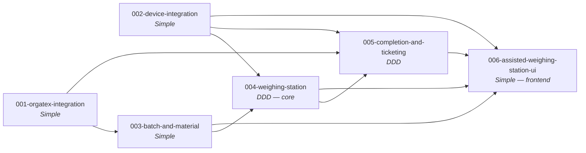

# Assisted Weighing Station - Unit Decomposition

## Approach

Decomposition is **capability-oriented**, not screen-oriented. Inputs: approved `requirements.md`, `system-context.md` (boundaries B1–B6), `ui-analysis.md`, project type `full-stack-web` (catalog: backend = domain-driven / DDD bolts by default; frontend = feature-based / simple bolts) and `system-architecture.md` (modular monolith, ports & adapters).

Units follow the **integration boundaries** (each external system behind its own port + dummy) and the **bounded contexts** of the domain (batch & material, weighing, completion). All units live in one repository and one process; "independently developable" here means: own module(s), own interface (port or API), own tests, buildable and testable without the other units' implementations (using test doubles at the ports).

### Candidate capabilities evaluated (workbook Step 10)

| Candidate | Decision | Reason |
|-----------|----------|--------|
| Batch Management | **Merged** with Recipe & Material → `003-batch-and-material` | Queue, selection rules and recipe retrieval share the same OrgaTEX data and the same consumer (weighing). Splitting would create two thin units with one interface between them |
| Recipe & Material Management | **Merged** (above) | Recipes are read-only; "material" (dyestuff, lots, containers) is lookup/validation over the same data |
| Weighing Station | **Kept** → `004-weighing-station` (core domain, DDD) | The heart of the product: the weighing session aggregate and every rule (scale selection, tolerance, confirmation, overshoot, override, progression, completion). Much more than the Weigh screen |
| Scale Integration | **Widened** → `002-device-integration` (scale + scanner + printer) | All three are local station devices with the same pattern (port, adapter, dummy, status, `_sim` controls, availability detection). Scanner and printer alone would be units of one or two small requirements each. Scale stays its own bolt |
| OrgaTEX Integration | **Kept** → `001-orgatex-integration` | Separate external system, separate data owner (`orgatex.db`), highest-risk assumption (A-01/A-02); must be replaceable by a real adapter in isolation |
| Ticket & Printing | **Reshaped** → `005-completion-and-ticketing` | The *printer* is a device (→ `002`); the *ticket* and the *OrgaTEX write-back* are both batch-completion outputs with their own state (CONFIRMED/PENDING, printed/failed, reprint). Grouping them gives one cohesive "what happens after the last component" context |
| *(added)* Station UI | **Added** → `006-assisted-weighing-station-ui` | Required by project type (frontend unit `{intent}-ui`); all three screens, status strip, Training Panel |

---

## Units Overview

This intent decomposes into **6 units** of work.

### Unit 1: 001-orgatex-integration

**Description**: The Dummy OrgaTEX external system (training substitute) and WeighingMS's `OrgatexPort` + adapter. Supplies batches, recipes, lots and batch status; accepts consumption postings idempotently; can simulate being unreachable. Translates dummy errors into WeighingMS error codes.

**Unit type**: backend (integration) · **Bolt type**: Simple Construction Bolt

**Assigned requirements**: DB-1, DB-6 (OrgaTEX controls); provides the external side of FR-2, FR-5, FR-27, FR-28, FR-36; NFR-7 (idempotent posting)

**Stories**: defined in Step 11

**Deliverables**: `/ext/orgatex` API + `orgatex.db` + seed; `OrgatexPort` interface; dummy adapter; `_sim` offline control; contract tests

**Dependencies**: Depends on: none · Depended by: 003, 005

**Estimated Complexity**: M

### Unit 2: 002-device-integration

**Description**: Dummy Scale, Dummy Scanner and Dummy Printer (training substitutes) and their ports/adapters, plus the `/api/scales/...` facade. Scale: two scales, simulated gross/tare, net weight, stability, connection, calibration due, tare command, simulated dispense/overshoot. Scanner: scan injection and delivery, online/offline. Printer: accept/store/preview tickets, READY/OFFLINE/OUT_OF_PAPER.

**Unit type**: backend (integration) · **Bolt type**: Simple Construction Bolt

**Assigned requirements**: FR-10, FR-14, FR-33, FR-34; DB-2, DB-3, DB-4, DB-6 (device controls); NFR-1, NFR-3

**Stories**: defined in Step 11

**Deliverables**: `/ext/scale`, `/ext/scanner`, `/ext/printer`; `ScalePort`, `ScannerPort`, `PrinterPort`; adapters; `/api/scales`, `/api/scales/:id/status|weight|tare`; `_sim` controls; contract tests

**Dependencies**: Depends on: none · Depended by: 004, 005, 006

**Estimated Complexity**: M

### Unit 3: 003-batch-and-material

**Description**: WeighingMS's batch and material context: the station batch queue, batch selection rules (release check), recipe retrieval and mapping to the domain model, dyestuff lot and container lookup/validation, and behaviour when OrgaTEX is unreachable at load time. Exposes `/api/batches`, `/api/batches/:id`, `/api/batches/:id/recipe` and material validation.

**Unit type**: backend · **Bolt type**: Simple Construction Bolt (read-side, thin rules)

**Assigned requirements**: FR-2, FR-3, FR-4, FR-5, FR-8, FR-9, FR-36; NFR-2

**Stories**: defined in Step 11

**Deliverables**: batch/recipe/material domain types and services; `/api/batches…` facade over `OrgatexPort`; container master (seed); lot/container validation; error mapping

**Dependencies**: Depends on: 001 (via `OrgatexPort`) · Depended by: 004, 006

**Estimated Complexity**: M

### Unit 4: 004-weighing-station

**Description**: The core domain. Operator session and identification; the **weighing session** aggregate per batch (component states, active component, resume); per-component preparation (identity verification, lot/container in force, automatic tare); **automatic scale selection** and supervisor reselection; calibration enforcement; **tolerance evaluation**; **server-authoritative confirmation** with immutable, snapshotted weighing records; overshoot detection and recovery (rule from Step 24); supervisor override; re-tare; quit/abandon; progression; batch-completion guard; audit trail. Pure rules live in `src/shared/domain/` for reuse by the UI.

**Unit type**: backend (core domain) · **Bolt type**: **DDD Construction Bolt**

**Assigned requirements**: FR-1, FR-6, FR-7, FR-11, FR-12, FR-13, FR-17, FR-18, FR-19, FR-20, FR-21, FR-22, FR-23, FR-24, FR-25, FR-26, FR-37; DB-5; NFR-4, NFR-5, NFR-6, NFR-8, NFR-9, NFR-14

**Stories**: defined in Step 11

**Deliverables**: domain model (session, component weighing, record, override, audit event); shared pure rule functions; application services; `/api` endpoints for session, component actions, confirm, override, re-tare, quit, complete; `weighingms.db` schema; seed (operators, supervisor, containers)

**Dependencies**: Depends on: 002 (`ScalePort`, `ScannerPort`), 003 (batch, recipe, material) · Depended by: 005, 006

**Estimated Complexity**: XL

### Unit 5: 005-completion-and-ticketing

**Description**: What happens after the last component: OrgaTEX consumption write-back orchestration (build posting from confirmed records, idempotency key, CONFIRMED / PENDING, retry, pending count) and the weighing ticket (compose content from records, barcode of batch ID, print via `PrinterPort`, preview, printer-failure retry, reprint marked REPRINT).

**Unit type**: backend · **Bolt type**: **DDD Construction Bolt** (write-back state machine, idempotency, ticket entity)

**Assigned requirements**: FR-27, FR-28, FR-29, FR-30, FR-35

**Stories**: defined in Step 11

**Deliverables**: write-back and ticket domain; `/api/batches/:id/consumption`, `/api/tickets` (+ reprint, retry); audit events WRITEBACK_RETRY, REPRINT

**Dependencies**: Depends on: 001 (`OrgatexPort`), 002 (`PrinterPort`), 004 (completed session and records) · Depended by: 006

**Estimated Complexity**: L

### Unit 6: 006-assisted-weighing-station-ui

**Description**: The station UI reproducing the prototype's HMI screen: sign-in, 1 · Select batch, 2 · Weigh, 3 · Confirm & print, top bar, status strip, supervisor dialog, F-key handling, message catalogue, and the separate Training Panel. Contains the UI workflow state machine; consumes only `/api`; never holds scenario data.

**Unit type**: frontend · **Bolt type**: Simple Construction Bolt

**Assigned requirements**: FR-15, FR-16, FR-31, FR-32; DB-7; NFR-10, NFR-11, NFR-12, NFR-13 — and the user-facing presentation of every other FR

**Stories**: defined in Step 11

**Deliverables**: React SPA (screens, components per `ux-guide.md`), typed API client, workflow reducer, Training Panel page, Playwright E2E suite (workbook Steps 29–30)

**Dependencies**: Depends on: 002, 003, 004, 005 (their `/api` contracts) · Depended by: none

**Estimated Complexity**: L

---

## Requirement-to-Unit Mapping

Every FR is assigned to exactly one unit (the unit that **owns the behaviour**). Units that provide supporting capability are noted.

| FR | Requirement | Unit | Supported by |
|----|-------------|------|--------------|
| FR-1 | Operator identification | 004-weighing-station | 006 |
| FR-2 | Batch queue | 003-batch-and-material | 001, 006 |
| FR-3 | Batch selection by touch or scan | 003-batch-and-material | 002 (scanner), 006 |
| FR-4 | Reject batches not released | 003-batch-and-material | 001 |
| FR-5 | Recipe loading | 003-batch-and-material | 001 |
| FR-6 | Component list and states | 004-weighing-station | 006 |
| FR-7 | Dyestuff identity verification | 004-weighing-station | 002 (scanner) |
| FR-8 | Dyestuff lot | 003-batch-and-material | 001, 004 |
| FR-9 | Container | 003-batch-and-material | 004 |
| FR-10 | Tare | 002-device-integration | 004 |
| FR-11 | Automatic scale selection | 004-weighing-station | 002 |
| FR-12 | Supervisor manual scale reselection | 004-weighing-station | 006 |
| FR-13 | Scale calibration status | 004-weighing-station | 002 |
| FR-14 | Live weight | 002-device-integration | 006 |
| FR-15 | Target, weighed now, still to weigh | 006-assisted-weighing-station-ui | 004 (shared rules) |
| FR-16 | Progress bar with tolerance band | 006-assisted-weighing-station-ui | 004 (shared rules) |
| FR-17 | Tolerance evaluation and signalling | 004-weighing-station | 006 |
| FR-18 | Confirmation gating | 004-weighing-station | 006 |
| FR-19 | Confirmation record | 004-weighing-station | — |
| FR-20 | Overshoot detection | 004-weighing-station | 006 |
| FR-21 | Overshoot recovery (rule at Step 24) | 004-weighing-station | 006 |
| FR-22 | Supervisor override | 004-weighing-station | 006 |
| FR-23 | Re-tare | 004-weighing-station | 002 |
| FR-24 | Quit and resume | 004-weighing-station | 006 |
| FR-25 | Component progression | 004-weighing-station | 006 |
| FR-26 | Batch completion | 004-weighing-station | 006 |
| FR-27 | OrgaTEX consumption write-back | 005-completion-and-ticketing | 001 |
| FR-28 | Write-back hold and retry | 005-completion-and-ticketing | 001, 006 |
| FR-29 | Ticket generation and print / preview | 005-completion-and-ticketing | 002 (printer), 006 |
| FR-30 | Ticket reprint | 005-completion-and-ticketing | 006 |
| FR-31 | Next batch | 006-assisted-weighing-station-ui | 003 |
| FR-32 | Peripheral and connection status bar | 006-assisted-weighing-station-ui | 001, 002 |
| FR-33 | Scale unavailable | 002-device-integration | 004, 006 |
| FR-34 | Scanner unavailable | 002-device-integration | 006 |
| FR-35 | Printer unavailable | 005-completion-and-ticketing | 002 |
| FR-36 | OrgaTEX unavailable when loading | 003-batch-and-material | 001, 006 |
| FR-37 | Audit trail | 004-weighing-station | 005 |

**Count per unit:** 001: 0 FR (DB-1, DB-6) · 002: 4 FR · 003: 7 FR · 004: 17 FR · 005: 5 FR · 006: 4 FR (+ presentation of all) = **37 / 37**.

**Training-only and NFR items:** DB-1 → 001 · DB-2, DB-3, DB-4 → 002 · DB-5 → 004 · DB-6 → 001 (OrgaTEX controls) and 002 (device controls) · DB-7 → 006 · NFR-1, NFR-3 → 002 · NFR-2 → 003 · NFR-4, 5, 6, 8, 9, 14 → 004 · NFR-7 → 001 · NFR-10–13 → 006.

---

## Unit Dependency Graph



```text
001-orgatex-integration ──► 003-batch-and-material ──► 004-weighing-station ──► 005-completion-and-ticketing ──► 006-…-ui
            │                                              ▲                        ▲                                  ▲
            └──────────────────────────────────────────────┼────────────────────────┘                                  │
002-device-integration ────────────────────────────────────┴────────────────────────┴──────────────────────────────────┘
```

No cycles. 001 and 002 have no dependencies and can be built in parallel.

## Execution Order

1. **001-orgatex-integration** and **002-device-integration** (foundation; parallelisable). The first bolt executed also establishes the shared project scaffold (Fastify app factory, Vite, shared contract types, decimal helpers, error handler, test setup) per the standards.
2. **003-batch-and-material**.
3. **004-weighing-station** (largest; several DDD bolts; overshoot bolt follows the Step 24 decision).
4. **005-completion-and-ticketing**.
5. **006-assisted-weighing-station-ui** — UI bolts can start as soon as the API they need exists (queue after 003, weigh after 004, done after 005); Playwright E2E last.

Exact bolt sequencing is fixed in the Bolt Plan (Step 12).

## Independence check

| Unit | Separate module/team? | Clear interface | Failure contained | Testable alone |
|------|-----------------------|-----------------|-------------------|----------------|
| 001 | ✅ `integrations/orgatex` | `OrgatexPort` + `/ext/orgatex` | ✅ errors translated at adapter | ✅ contract tests |
| 002 | ✅ `integrations/{scale,scanner,printer}` | 3 ports + `/ext/*` + `/api/scales` | ✅ status + error codes | ✅ contract tests |
| 003 | ✅ `modules/batches` | `/api/batches…` | ✅ OrgaTEX outage → defined 503 | ✅ with fake `OrgatexPort` |
| 004 | ✅ `modules/weighing` + `shared/domain` | session/component `/api` | ✅ device outage → safe state | ✅ pure rules + fake ports |
| 005 | ✅ `modules/completion` | `/api/batches/:id/consumption`, `/api/tickets` | ✅ write-back PENDING, printer retry | ✅ with fake ports |
| 006 | ✅ `src/web` | consumes `/api` only | ✅ every API error → visible state | ✅ component tests + mocked API; E2E |

Deployment is a single local process (`tech-stack.md`), so "independently deployable" is not applicable; replaceability is achieved at the port boundaries.
